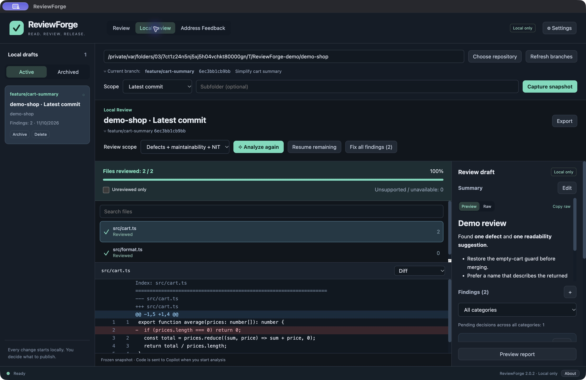
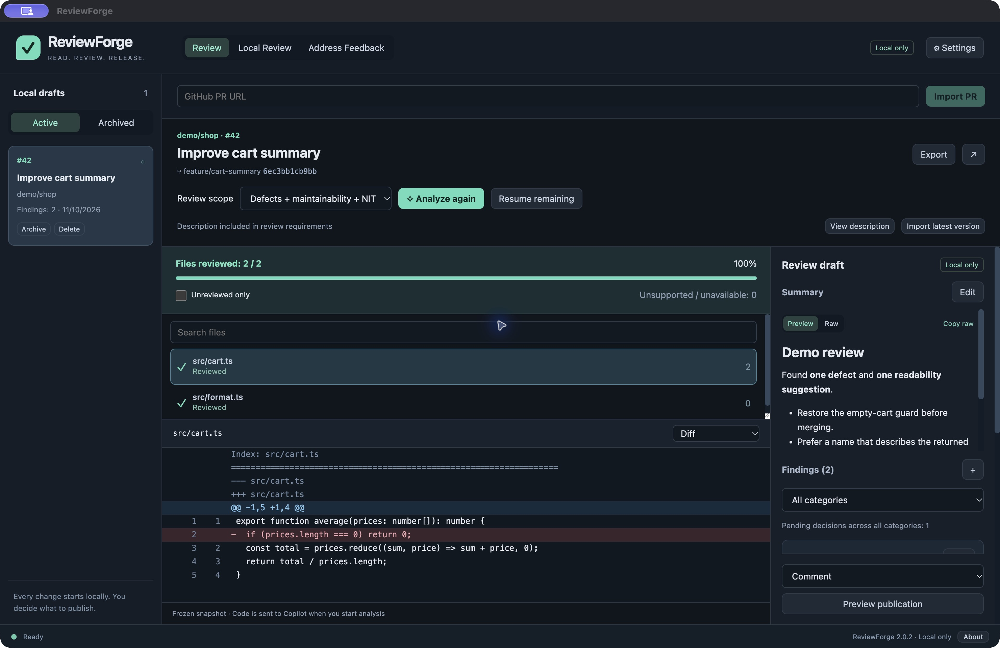
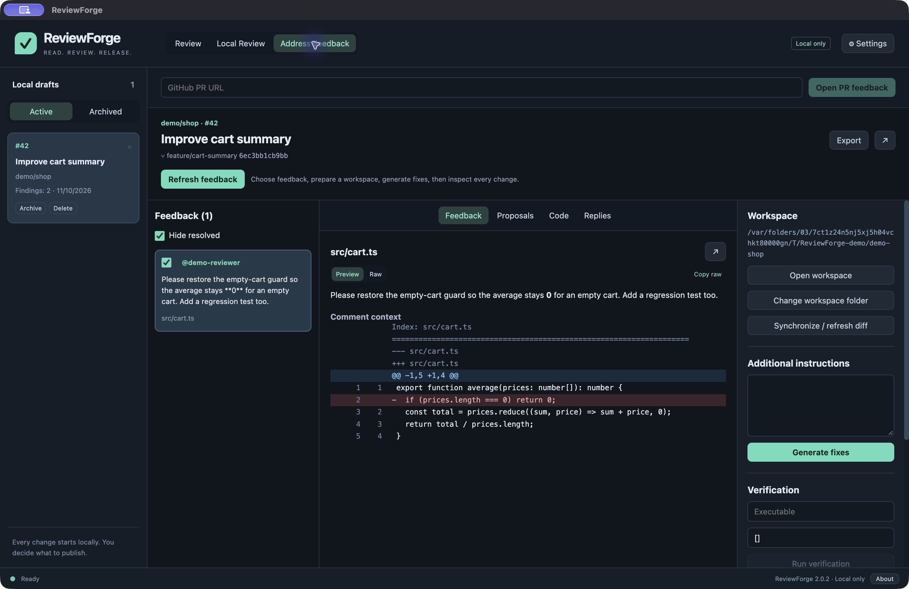
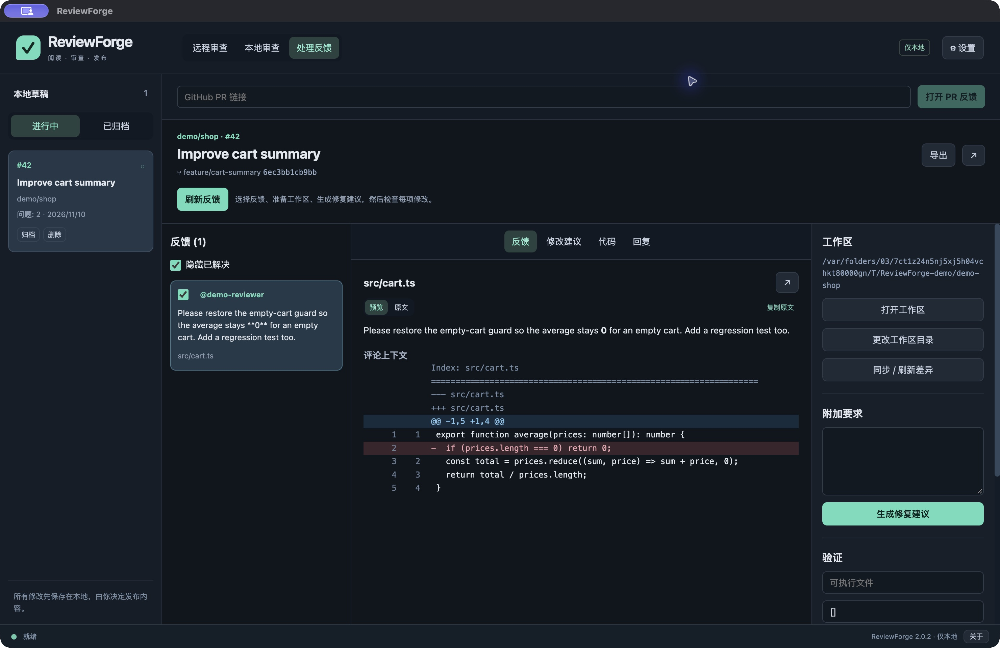

# ReviewForge Desktop

[English](README.md) · [简体中文](README.zh-CN.md) · [Download](https://github.com/ascube/ReviewForge/releases/latest) · [User guide](docs/USER_GUIDE.md) · [Report an issue](https://github.com/ascube/ReviewForge/issues)

 

**Review code. Understand feedback. Approve every publication.**

## Personal project · no company information

**This public repository, its release documentation and screenshots contain no company source code, internal documents, business data, credentials, or private repository information.** The screenshots use synthetic demonstration data. This is a personal project by Kevin Sun, not an official or endorsed IHG, GitHub or Microsoft product.

### Why GitHub Copilot?

**GitHub Copilot is the tool mandated for my work, so I chose it as ReviewForge's AI backend.** The aim is to bring a structured, evidence-based review workflow to the tool I already have to use. This choice does not imply that any company code, internal system or company-provided credential is included in this project.

You connect your own authorized account and choose the repositories to review. When you start AI analysis or generation, the selected context is sent to GitHub Copilot; follow the repository owner's rules for sharing code. The absence of company data in this public distribution is separate from what you later choose to review locally.




*Actual macOS interface with synthetic demonstration data. Screenshots are illustrative, not a live GitHub PR or a new Copilot result.*

A macOS + Windows desktop application for local-first code review and addressing GitHub PR feedback, powered by GitHub Copilot. Built with Electron, TypeScript and React.

## Download and install

Get the installers from **[GitHub Releases](https://github.com/ascube/ReviewForge/releases/latest)**. Release assets include macOS Apple Silicon and Intel DMG/ZIP, Windows x64 EXE/ZIP, source, documentation, dependency notices and SHA-256 checksums. See the [installation guide](docs/USER_GUIDE.md#installation).


- **macOS Apple Silicon / Intel:** open the `.dmg` and drag **ReviewForge Desktop** to Applications. The `.zip` also contains the complete application.
- **Windows x64:** run `ReviewForge-Desktop-2.0.2-Windows-x64.exe`. The public installer installs for the current user. A portable `.zip` is also available.
- Git and the platform-specific Copilot runtime are bundled. End users do not need Node.js, Python, Xcode, or a separate Git installation for the app’s repository operations. Project test commands still need their normal project toolchain.
- This development distribution is not Developer ID notarized or Authenticode signed. Production distribution should be signed with the publisher’s certificates. Native platform CI checks are recorded in GitHub Actions. Windows installation and interactive UI acceptance still require manual validation.

## Set up the app — step by step

1. **Install and launch:** download the matching installer from [Releases](https://github.com/ascube/ReviewForge/releases/latest), install it, then open ReviewForge Desktop.
2. **Choose a language:** open **Settings → Language**. English is the first-launch default; Simplified Chinese is optional and your choice is saved.
3. **Connect GitHub for PR workflows:** enter your authorized GitHub credential under **GitHub token**, then click **Check GitHub**. Local-only review does not require a GitHub publishing credential.
4. **Connect Copilot:** enter an authorized Copilot-compatible token under **Copilot token**, or leave it empty to use an existing GitHub CLI login. A saved Copilot token takes priority. Click **Check Copilot / load models**.
5. **Choose a model:** select a model returned by the connection check, or leave the default. Account entitlement and organization access rules still apply.
6. **Set local preferences:** choose a data directory if desired. If you plan to commit from ReviewForge, enter your own **Commit author** name and email; these are your Git commit details, not the tool author's contact details.
7. **Save settings**, then start with **Local Review → Choose repository → Latest commit → Capture snapshot → Analyze** on a repository you are authorized to use.
8. **Inspect before publishing:** review each finding/proposal; pushing code, posting reviews and resolving feedback each require their own preview and approval.

See the [detailed setup guide](docs/SETUP.md) for credential steps, account switching and troubleshooting. Never put tokens or company information in public issues or screenshots.

## Build from source — step by step

1. Install **Git** and **Node.js 24+** (npm is included). Confirm `git --version`, `node --version` and `npm --version` work in Terminal or PowerShell.
2. Clone the public repository:

   ```sh
   git clone https://github.com/ascube/ReviewForge.git
   cd ReviewForge
   ```

3. Install the locked dependencies:

   ```sh
   npm ci
   ```

4. Typecheck, run the tests and build:

   ```sh
   npm run check
   ```

5. Run the desktop app locally:

   ```sh
   npm start
   ```

6. Create an installer **on the target operating system**:

   ```sh
   npm run make
   ```

   On macOS, find the DMG/ZIP under `out/make/`; on Windows, find the Setup EXE/ZIP under `out/make/`. The default build uses the machine's CPU architecture. Locally built packages are unsigned unless you configure publisher signing.

No company repository, credential, private package registry or internal service is required to build or run the automated tests. AI requests require your own authorized Copilot access after startup. Read the [full source-build guide](docs/BUILDING.md) for platform details, expected output, optional Windows NSIS packaging and troubleshooting.

## Screenshots

| PR review | Address feedback |
| --- | --- |
|  |  |



## About

ReviewForge was created by **Kevin Sun** — an IT guy working for IHG. The bilingual About page explains the decision to open-source this long-used personal tool in response to code reviews driven by personal preferences rather than shared standards. Open it from the application menu or the bottom About button.

## First launch

English is the default, independent of the operating system language. Select **Settings → Language → 简体中文** to switch; the choice is saved immediately. Menus, controls, dialogs and errors support both languages. User-authored content, file paths and previously generated text stay unchanged.

Configure separate GitHub and Copilot credentials in Settings. Credentials are encrypted by the operating system. A saved Copilot credential takes priority; otherwise the app can use an existing GitHub CLI login. The bundled runtime runs with its own data directory; a login stored only in another application is not imported. Use **Check Copilot / load models** before the first review. A valid Copilot entitlement and any organization-required SSO/VPN access are still needed.

GitHub publishing credentials are only used by the application’s GitHub/Git services. They are not given to model tools. Review/fix/reply requests send the selected code and context to GitHub Copilot when you start the operation.

Use **Settings → Local data → Change data directory** to copy local reviews and managed workspaces to another location. The original directory is retained. Open or change an individual PR workspace from the Address Feedback workspace controls.

## Remote PR review

1. Paste a `https://github.com/owner/repository/pull/number` URL under **Review** and import it.
2. Read the captured PR description. It is part of Copilot’s review criteria; a missing or template-comment-only description is visibly flagged.
3. Choose **Defects + maintainability + NIT** (default) or **Defects only**, then **Analyze**. Files are reviewed sequentially, with large content divided into parts. **Resume remaining** retries unfinished work without discarding completed parts.
4. Use the file list, highlighted completion state, category filter, diff, full-file view and Markdown assessment. The first diff column contains the manual finding button.
5. Edit each finding and explicitly choose **Include** or **Exclude**. Edit the summary and choose Comment, Approve PR, or Request changes.
6. **Preview publication → Approve review → Publish review**. Code/description changes on GitHub invalidate publication. An interrupted publication is reconciled against its unique marker before any retry, avoiding duplicate reviews.

GitHub’s own API limits and unavailable/truncated patches are reported explicitly. Binary/non-UTF-8 files and unsupported entries remain visible as unreviewed; they are never labeled successfully reviewed. Approving a PR requires completed coverage. A single review supports up to 50 included inline findings; this is shown before publication.

## Local repository review

1. Under **Local Review**, choose the external repository. The current branch and commit are read directly without checkout.
2. Choose **Uncommitted changes**, **Branch changes**, **Latest commit**, or **Whole repository**. Branch comparison uses a picker and the merge base of the current HEAD and selected local ref; it does not fetch or switch branches. Whole repository captures current working-tree text, including non-ignored untracked files. Latest commit excludes uncommitted changes.
3. Optionally choose a subfolder and **Capture snapshot**. Git ignore rules are respected, including ignored generated files accidentally tracked by Git.
4. Analyze, filter, edit and export the local report. There is no 160-file or 500-KB aggregate exclusion. Unsupported or unavailable files are listed separately with reasons.
5. **Fix all findings** drafts changes for all non-excluded findings. Review/edit individual proposals, preview the exact diff, and **Apply selected changes**. Only this explicit action writes files. New files and file deletions are supported. Existing LF/CRLF/mixed endings and final-newline conventions are preserved by the host application.

Local snapshots are immutable. After applying a repair or editing externally, capture a new snapshot to review the new state.

## Address PR feedback

1. Under **Address Feedback**, enter a PR URL and **Open PR feedback**, or select an imported PR and load/refresh feedback.
2. Resolved and outdated threads are labeled. **Hide resolved** filters them out, including selected resolved threads. Select the feedback to address.
3. Prepare an isolated workspace using an existing local repository as the source, or clone the PR repository. The original source checkout stays unchanged. The isolated workspace is checked out at the PR source commit.
4. Generate local fix proposals with Copilot, or **Open workspace** and edit using another editor. Preview/edit and apply proposals explicitly. Run a trusted verification executable with a JSON argument array; no shell is implicitly invoked.
5. **Synchronize / refresh diff** detects external commits, amendments and externally pushed changes. Preview and approve the exact code state. Commit locally if necessary, then synchronize/preview/approve the resulting commit before push. Amended history requires the explicit rewrite checkbox. All pushes use an expected-remote-SHA lease; remote changes invalidate the operation.
6. Generate reply drafts **before or after push**, grounded in the selected comment and actual local diff. Preview and edit each Markdown draft. An unpushed draft cannot be published or resolved.
7. Once the PR source HEAD is confirmed equal to the clean local HEAD, preview the reply/resolve plan, approve it, then publish. Reply and resolve progress is checkpointed per item. **Verify previous replies** reconciles uncertain results instead of blindly posting duplicates.

Code approval, review publication approval and reply/resolve approval are separate. Editing content or changing code invalidates the relevant approval.

## Data and safety

Drafts use a local SQLite database with crash recovery. Archive/restore, explicit deletion, and Markdown export are available. Deleting a review does not delete a source repository. Uncertain publication records cannot be deleted until reconciled.

Model capabilities are restricted to reading supplied/frozen repository text and returning findings, file proposals or reply drafts. The model does not receive terminal, commit, push, GitHub publication or resolve tools. Repository text and PR comments are treated as untrusted context. The renderer is sandboxed, has no Node integration, and uses a narrow IPC bridge. Remote Markdown HTML/images cannot execute or trigger background requests.

## License and third-party software

ReviewForge source code and original assets are licensed under the [MIT License](LICENSE), copyright © 2026 Kevin Sun. Bundled third-party components retain their own licenses; the MIT grant does not relicense Git, Electron/Chromium, or GitHub Copilot. See [THIRD_PARTY_NOTICES.md](THIRD_PARTY_NOTICES.md). A Copilot account with the required access is needed to use AI features.

This is a personal project by Kevin Sun, an IT guy working for IHG. It is not an official IHG, GitHub or Microsoft product.

Public installer checksums are attached to each GitHub Release as `SHA256SUMS`; use the file from the same release as your download. Source tags may contain historical local build records whose checksums differ from cloud-built installers.

## Contributing and support

Read [CONTRIBUTING.md](CONTRIBUTING.md), use the [issue tracker](https://github.com/ascube/ReviewForge/issues) for bugs and feature requests, and see [SECURITY.md](SECURITY.md) for sensitive reports. Do not attach credentials, private repository content or unredacted logs to public issues.

## Development

Use Node.js 24+ and npm. Build each platform with its matching native runtime dependencies.

```sh
npm ci
npm run check
npm start
npm run make          # native platform: macOS DMG/ZIP, Windows Squirrel setup/ZIP
npm run make:windows  # isolated Windows x64 NSIS + ZIP cross-build
```

The cross-build script creates `.cache/windows-stage`, installs Windows-specific production dependencies, verifies official Electron/embedded-Git checksums, and packages a self-contained NSIS installer. It does not modify the macOS dependency installation. Native dependencies are unpacked from ASAR so Copilot’s dynamic libraries resolve correctly.

`.github/workflows/build.yml` runs checks, native packaging and a packaged Git/SQLite/Copilot-runtime smoke test on macOS ARM64, macOS x64 and Windows x64. See [Actions](https://github.com/ascube/ReviewForge/actions) for actual build and smoke-test results.

For macOS signing, configure `APPLE_SIGN_IDENTITY` and optionally `APPLE_API_KEY`, `APPLE_API_KEY_ID`, `APPLE_API_ISSUER`. Native Windows Forge signing accepts `WINDOWS_CERTIFICATE`/`WINDOWS_CERTIFICATE_PASSWORD`; the NSIS script uses electron-builder’s `CSC_LINK`/`CSC_KEY_PASSWORD`. No signing credentials are included in this project.

See [VALIDATION.md](VALIDATION.md) for the actual validation performed and platform limits.
