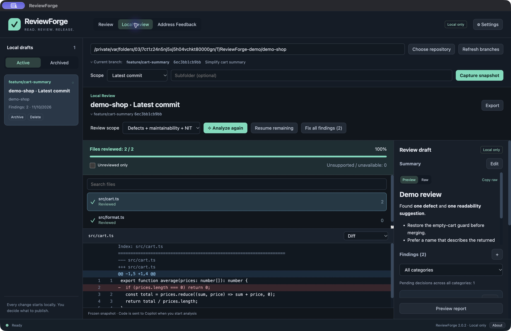
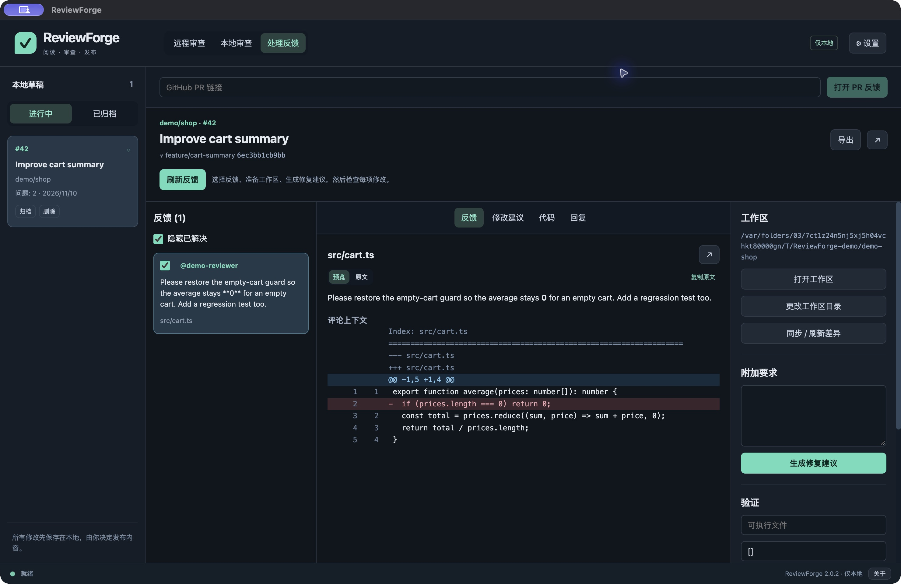

# ReviewForge Desktop

[English](README.md) · **简体中文** · [下载安装包](https://github.com/ascube/ReviewForge/releases/latest) · [完整使用指南](docs/USER_GUIDE.zh-CN.md)

**审查代码、处理反馈，每次发布由你确认。**

## 个人项目 · 不含任何公司内部信息

**本公开仓库、发行文档和截图不包含任何公司源码、内部文档、业务数据、凭据或私有仓库信息。** 截图仅使用合成演示数据。这是 Kevin Sun 的个人项目，并非 IHG、GitHub 或 Microsoft 的官方或背书产品。

### 为什么后台使用 GitHub Copilot？

**因为 GitHub Copilot 是工作中规定使用的工具，所以我选择它作为 ReviewForge 的 AI 后台。** 我希望在既定工具之上，建立更有依据、更一致的代码审查流程。这不表示本项目包含公司代码、内部系统或公司提供的凭据。

使用时连接你自己有权使用的账号，并自行选择仓库。开始 AI 分析或生成时，选定上下文会发送给 GitHub Copilot，请遵循仓库所有者的使用规则。“公开发行内容不含公司信息”与用户后续自行选择的审查内容是两回事。


ReviewForge 是基于 Electron、TypeScript 和 React 的 macOS / Windows 桌面应用，使用 GitHub Copilot 审查远程 PR 和本地仓库，生成修复与回复草稿。所有内容先保存在本地，预览并批准后才能发布。



*截图来自实际 macOS 应用，使用合成演示数据；不代表真实 PR 或新生成的 Copilot 结果。*

## 下载与安装

到 [Releases](https://github.com/ascube/ReviewForge/releases/latest) 下载：

| 系统 | 推荐安装包 | 其他选项 |
| --- | --- | --- |
| macOS Apple Silicon / Intel | `.dmg`，拖到 Applications | `.zip` |
| Windows x64 | `.exe`，安装到当前用户目录 | 便携 `.zip` |

已内置 Git 和 Copilot 运行时，普通用户无需安装 Node.js、Python、Xcode 或 Git。运行仓库测试仍需项目自己的工具链。当前发布未做 Apple 公证或 Windows 发布者签名；公开安装包来自原生平台 CI 构建，运行时检查结果见 Actions；Windows 安装及交互界面仍需人工验收。详细要求和校验方法见[安装指南](docs/USER_GUIDE.zh-CN.md#安装)。

## 首次设置：一步一步操作

1. **安装并启动：** 从 [Releases](https://github.com/ascube/ReviewForge/releases/latest) 下载对应系统和架构的安装包，安装后启动 ReviewForge Desktop。
2. **选择语言：** 打开 **Settings → Language**。首次默认英文，可选简体中文并保存选择。
3. **连接 GitHub：** 使用 PR 功能时，在 **GitHub token** 中填写你有权使用的凭据，再点 **Check GitHub／检查 GitHub**。仅做本地审查不需要 GitHub 发布凭据。
4. **连接 Copilot：** 点击 **Sign in with browser／通过浏览器登录**，复制验证码并在 GitHub 确认授权，应用自动加载模型并复用登录。已有批准的 token 和 GitHub CLI 凭据仍受支持。
5. **选择模型：** 从连接检查返回的模型中选择，或使用默认模型。账号权限、订阅及组织访问规则仍然适用。
6. **设置本地偏好：** 可更改数据目录。若要在应用内提交代码，填写你自己的 **Commit author／提交作者** 姓名和邮箱；这是 Git 提交信息，不是工具作者的联系方式。
7. **保存设置：** 先用自己有权使用的仓库执行 **本地审查 → 选择仓库 → 最新提交 → 捕获快照 → 分析**。
8. **审核后再发布：** 逐条检查发现或修复提案；代码推送、审查发布以及回复／解决评论，各自需要预览和批准。

详见[逐步设置指南](docs/SETUP.zh-CN.md)。不要在公开 Issue 或截图中放入 token、公司信息。

## 从源码构建：一步一步操作

1. 安装 **Git** 和 **Node.js 24+**（包含 npm）。在 Terminal 或 PowerShell 中确认 `git --version`、`node --version`、`npm --version` 可用。
2. 获取公开源码：

   ```sh
   git clone https://github.com/ascube/ReviewForge.git
   cd ReviewForge
   ```

3. 安装锁定版本的依赖：

   ```sh
   npm ci
   ```

4. 检查类型、运行测试并构建：

   ```sh
   npm run check
   ```

5. 本地运行桌面应用：

   ```sh
   npm start
   ```

6. **在目标系统上**生成安装包：

   ```sh
   npm run make
   ```

   macOS 的 DMG／ZIP、Windows 的 Setup EXE／ZIP 都在 `out/make/` 下。默认使用当前机器的 CPU 架构；未配置发布者签名时，产物为未签名版本。

构建和自动化测试不需要任何公司仓库、凭据、私有包源或内部服务；启动后使用 AI 功能才需要你自己的 Copilot 授权。平台细节、产物位置、可选 Windows NSIS 打包及排错见[完整构建指南](docs/BUILDING.zh-CN.md)。

## 主要功能

- **远程 PR 审查：** 读取 PR 描述作为审查依据，缺失时提示；默认缺陷、可维护性和 NIT，支持范围选择、分类筛选、逐文件进度和断点续审。
- **本地审查：** 自动读取当前分支，支持整个仓库、未提交修改、分支对比和最新提交；分支通过列表选择。忽略文件不计入审查，大文件分段，不因总文件数或总上下文大小而静默遗漏。
- **修复问题：** Copilot 先生成本地提案，逐项预览、修改、确认后应用，保留原有换行约定。
- **处理反馈：** 标注已解决与过期评论；本地仓库复制或克隆隔离工作区；同步外部 commit、amend 和 push。
- **回复与解决：** 推送前即可生成回复草稿；确认代码已经推送后，才允许预览批准并发布回复、标记 resolved。
- **本地优先：** SQLite 草稿、归档恢复、Markdown 预览及原文复制、可调整数据目录。代码批准、评论批准和回复批准互相独立。

## 开始使用

1. 首次启动默认英文，与系统语言无关。在 **Settings → Language → 简体中文** 切换，选择会保存。
2. 设置 GitHub 凭据，并通过浏览器登录 Copilot，或复用已有授权；点击 **检查 Copilot / 加载模型**。需要有效 Copilot 使用权限，企业 SSO/VPN 限制仍适用。
3. 选择 **远程审查**、**本地审查** 或 **处理反馈**，按[使用指南](docs/USER_GUIDE.zh-CN.md)操作。

只有启动 AI 操作时，选定代码和上下文才会发送给 GitHub Copilot。模型不具备终端执行、提交、推送、发布评论或解决线程的工具。



## 关于与许可证

**Kevin Sun** — *An IT guy working for IHG.*

长期以来，以个人偏好而非共同标准为依据的 code review，促使我决定开源这款长期个人使用的工具，希望让审查更有依据，并聚焦代码质量。这是个人项目，并非 IHG、GitHub 或 Microsoft 的官方产品。

ReviewForge 源码和原创资源使用 [MIT 许可证](LICENSE)。内置的第三方组件保留各自许可证，详见 [第三方声明](THIRD_PARTY_NOTICES.md)。

## 开发与支持

需要 Node.js 24+：`npm ci` → `npm run check` → `npm start`。打包方式参见[英文说明](README.md#development)。

欢迎提交 [Issue](https://github.com/ascube/ReviewForge/issues) 或 PR。请先阅读 [贡献指南](CONTRIBUTING.md)、[安全说明](SECURITY.md) 和 [验证记录](VALIDATION.md)。公开问题中不要上传凭据、公司代码或未脱敏日志。

## 功能对照与恢复

2.1 已补齐对照 Swift 版发现的工作流缺口，包括修复恢复副本、推送中断核实、发布身份检查、逐条回复建议、工作区内编辑和完整 Markdown 报告。详见[功能对照清单](docs/FEATURE_PARITY.zh-CN.md)。旧 Swift 数据迁移和 iPad 不属于本次 Windows/macOS 版本范围。
