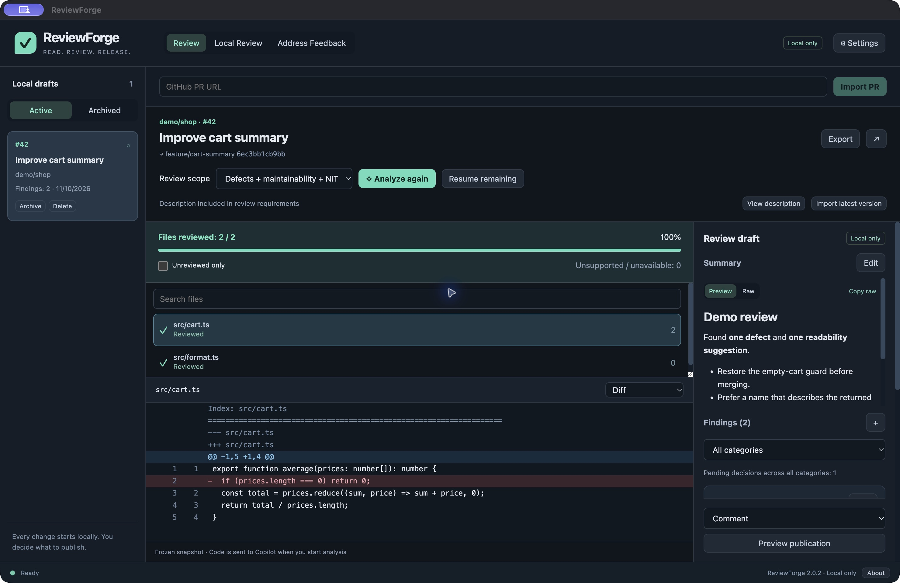
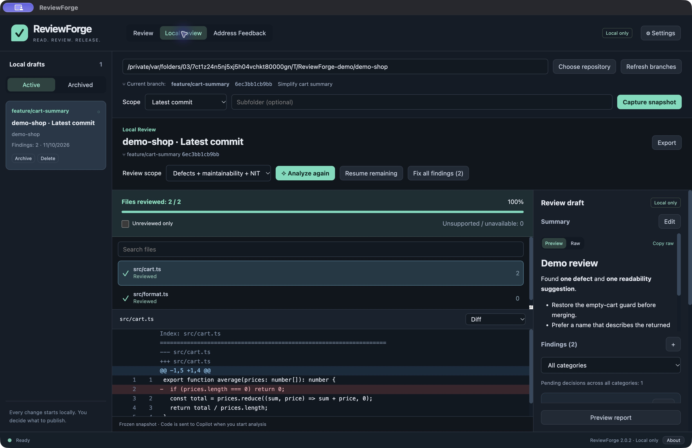
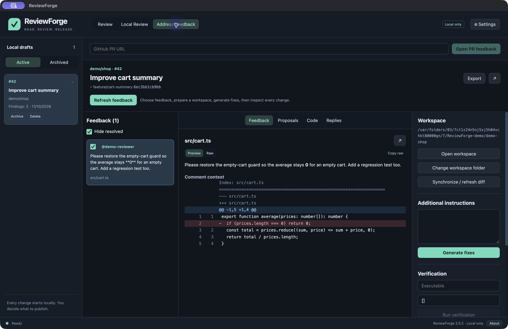

# ReviewForge user guide

[简体中文](USER_GUIDE.zh-CN.md) · [Home](../README.md)

See the [step-by-step setup](SETUP.md) and [source-build guide](BUILDING.md).

## Installation

Download from [GitHub Releases](https://github.com/ascube/ReviewForge/releases/latest). Select macOS Apple Silicon (arm64), macOS Intel (x64), or Windows x64; there is no Linux release. Use macOS 13+ or Windows 10/11 x64. The bundled Git LFS requires macOS 13+. Apple Silicon has been exercised locally; native CI build/runtime results are available in GitHub Actions. Windows and Intel interactive UI/installation acceptance remains outstanding.

- **macOS:** open the DMG and drag ReviewForge Desktop to Applications; launch from Applications. ZIP users extract the complete application first.
- **Windows:** run the EXE installer for the current user, then launch ReviewForge Desktop. For the portable ZIP, extract the entire directory before running ReviewForgeDesktop.exe; retain its accompanying resources.
- **Unsigned builds:** these releases have no Apple Developer ID notarization or Windows Authenticode publisher certificate. Follow your device or organization's security policy. Do not disable security protections to install the app.
- **Verify the download:** the release includes `SHA256SUMS`. On macOS use `shasum -a 256 <downloaded-file>`; on Windows PowerShell use `Get-FileHash -Algorithm SHA256 <downloaded-file>`. Match the corresponding SHA-256 value before opening. Checksums detect changed bytes; they are not publisher signatures.
- **Upgrade:** close the app and replace/install the new version. Local drafts are stored separately from the app. Back up your data directory before updating. There is no migration from the original Swift application.

## First launch and authentication

The initial language is English even on a Chinese operating system. Open **Settings → Language** to select Simplified Chinese; the choice is saved immediately. User content and paths are not translated.

GitHub and Copilot credentials are configured separately. GitHub repository operations need access to the target repository; publishing reviews, pushing and resolving threads additionally need the corresponding write permissions. Copilot needs an entitled account. See [GitHub's authentication documentation](https://docs.github.com/en/copilot/how-tos/copilot-sdk/auth/authenticate).

A configured Copilot token takes priority; otherwise the app can use the existing GitHub CLI login. An unrelated editor login is not automatically imported. Never put tokens in PR descriptions or review instructions. Use **Check GitHub** and **Check Copilot / load models** to verify access. Organizations may require SSO authorization, approved networks or VPN access. The app does not bypass those requirements.

Only configure credentials through the app or the provider's official login flow. Do not paste tokens into GitHub issues. Credentials are encrypted using the operating system. If macOS prompts for access to an existing keychain item, verify it is for ReviewForge before granting it.

## Remote PR review

1. Open **Review**, paste a github.com PR URL and click **Import PR**.
2. Read the captured description. Missing/template-only descriptions show a warning; product requirements in the description are review criteria.
3. Choose **Defects + maintainability + NIT** or **Defects only**. NIT means minor, usually non-blocking suggestions such as readability or naming improvements.
4. Start **Analyze**. Progress is shown by file and content part. If interrupted, use **Resume remaining**. Unsupported and unavailable files remain visible with reasons.
5. Inspect each finding against the diff. Filter by category, edit wording, add manual findings from the first diff column, and choose **Include** or **Exclude** for each finding.
6. Edit the summary and select the review event. **Approve PR** is distinct from approving publication in this app.
7. **Preview publication → Approve review → Publish review**. A stale remote commit/description invalidates approval. The app does not publish merely because analysis finished.

GitHub API patch limits can restrict coverage. A review supports at most 50 included inline findings. Full approval requires complete coverage. Uncertain publication results must be reconciled before retrying.

## Local review and automatic fixes

1. Choose a local Git repository in **Local Review**. ReviewForge reads the current branch and HEAD without checking out another branch.
2. Choose scope: **Uncommitted changes**, **Branch changes**, **Latest commit**, or **Whole repository**. Branch comparison chooses an existing local ref from a list; no implicit fetch occurs.
3. Optionally restrict to a subfolder, then **Capture snapshot**. Snapshots are frozen; recapture after subsequent edits.
4. Analyze and inspect the categorized report. Files matching ignore rules are excluded; binary/non-UTF-8 files, submodules, symlinks and unreadable files are shown as unsupported/unavailable. Large files are reviewed in parts, without a 160-file or 500-KB aggregate exclusion.
5. **Fix all findings** creates proposals for non-excluded findings. Preview and edit them before **Apply selected changes**. Applying is the only step that writes proposed changes. The app checks original contents and preserves line-ending conventions.
6. Run your project's tests and inspect the resulting Git diff. Capture a new snapshot for another review.

## Address feedback, push and replies

1. Open **Address Feedback** and import/open PR feedback. Resolved/outdated threads are labeled; **Hide resolved** hides them even if they were selected.
2. Select comments and prepare an isolated workspace from a local repository or by cloning. The source checkout is not the managed workspace.
3. Ask Copilot for local proposals, or open the workspace in your preferred editor. Preview/edit/apply proposals explicitly.
4. Run verification with a trusted executable and JSON argument array. Project toolchains must already be installed; the app does not silently run shell commands from comments.
5. Synchronize after external commit/amend/push. ReviewForge compares local HEAD with the PR source branch. Re-preview and approve after any code/commit change. Rewritten history requires explicit approval and an expected-remote-SHA push lease.
6. Generate replies before or after push, based on each selected comment and actual code changes. Edit every draft; do not describe checks you have not run.
7. Publish replies/resolve only after ReviewForge confirms the clean local HEAD is on the PR source branch. Preview the reply/resolve plan, approve it, and publish. Uncertain attempts require **Verify previous replies** before another attempt.

## Data, privacy and recovery

**Settings → Local data** shows the actual data directory. Change it to copy drafts and managed workspaces to a new location; the original remains. Archive completed work, restore from Archived, and export Markdown reports. Deleting a draft does not remove your original source repository.

Code and selected context go to GitHub Copilot only when you request AI work. ReviewForge is a personal desktop client, not a hosted code storage service. Follow your repository owner's rules for sharing code with AI. Markdown preview blocks remote image loading and raw HTML execution.

Back up the local data directory with the app closed. Credentials use the operating system's encryption and may not be portable to another machine. For a failed operation, preserve your workspace and use synchronize/resume/verify as appropriate; do not delete drafts to clear uncertain remote writes.

## Troubleshooting

| Symptom | Next step |
| --- | --- |
| Copilot is not signed in | Check the configured Copilot credential or GitHub CLI identity, then Check Copilot / load models. |
| Enterprise IP allow-list or SSO error | Use your organization's approved access method; retry after access is restored. |
| Files remain unreviewed | Inspect the reason; resume unfinished analysis or recapture an old snapshot. |
| Workspace HEAD changed | Synchronize, inspect the new diff and approve the new code state. |
| Replies cannot be published | Confirm a clean local HEAD is pushed, synchronize, then preview and approve replies. |
| Publication outcome is uncertain | Verify previous publication/replies; do not blindly retry. |
| Windows install/runtime problem | Report OS version, architecture, app version and redacted error via Issues; Windows acceptance is still pending. |

See [validation and distribution limits](../VALIDATION.md). Screenshots use synthetic examples and never include company repositories.
